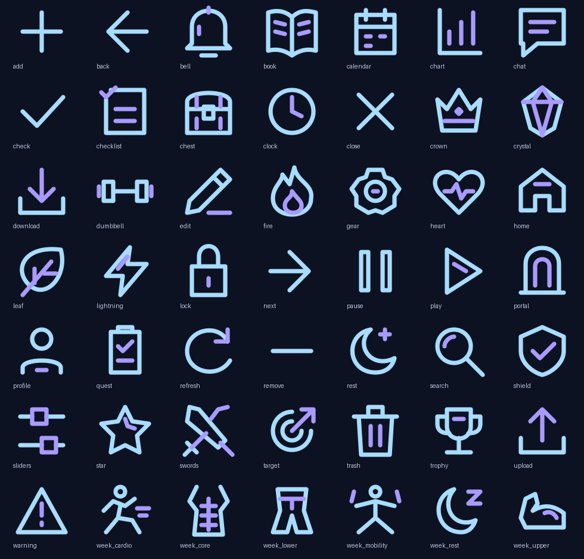

# Iconos Monarca V43.12

49 iconos vectoriales transparentes, en azul hielo (#A8DCFF) y violeta (#A99AFF).
Cuadrícula de 24 × 24, trazo de 1.8 unidades, extremos y uniones redondeados.
No contienen fondos, imágenes incrustadas, fuentes, filtros ni dependencias externas.

Fuentes editables: `app/src/main/assets/hunter-icons/`.
Recursos usados directamente por Compose: `app/src/main/res/drawable/hunter_icon_*.xml`.
Ambos se generan desde los mismos trazos con `python3 tools/generate_monarch_icons.py`.
La API `HunterPngIcon` conserva sus claves y usa `painterResource`, sin rasterizar
ni teñir los dos colores. El nombre histórico no implica que sean PNG.

La lámina tiene fondo oscuro solo para mostrar los trazos; los archivos SVG y los
VectorDrawable no tienen fondo. Usar preferentemente sobre las superficies oscuras
de Monarca, sin aplicar tint. A 24 dp o más se mantiene la legibilidad de los detalles.

Validación local: 49 SVG renderizados con Inkscape; esquinas transparentes;
coincidencia de cada path y color SVG con su VectorDrawable. Prueba Android
`HunterMinimalIconResolutionTest` pendiente: Gradle no pudo descargarse por las
restricciones de red del entorno. La fidelidad en dispositivo requiere comprobar
la APK compilada en Android; no se ha realizado aquí.
